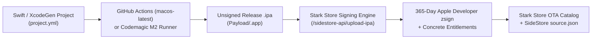

# Stark IPA Builder & Gothic iOS / watchOS / tvOS App Suite

Automated **XcodeGen + GitHub Actions (`macos-latest`) + TrueNAS OTA Signing** monorepo for building, signing, and publishing native iOS, watchOS, and tvOS `.ipa` packages to **Stark Store** (OTA `itms-services://`, SideStore, and AltStore source).

---

## Architecture & Build Pipeline



1. **Declarative Project Generation (`XcodeGen`):** Every app folder contains a [`project.yml`](./project.yml) specification that generates a clean `.xcodeproj` on the CI runner (`xcodegen generate`).
2. **Cloud Compilation (`GitHub Actions` / `Codemagic`):** Compiles `Release-iphoneos` / `Release-watchos` / `Release-appletvos` binaries with `CODE_SIGNING_REQUIRED=NO` and packages `Payload/<App>.app` into an `.ipa` artifact.
3. **Automated 365-Day Certificate Signing & Publishing:** Uploading an `.ipa` to `/sidestore-api/upload-ipa` automatically:
   - Extracts `Info.plist` metadata (`CFBundleIdentifier`, `CFBundleShortVersionString`, `CFBundleDisplayName`, and `AppIcon`).
   - Synthesizes concrete entitlements (`application-identifier`, `com.apple.developer.team-identifier`, `keychain-access-groups`, and `application-groups`) for the main app and any nested extensions or `Watch/*.app` companion bundles.
   - Signs all binaries inside-out with `zsign` using the active 365-day Apple Developer `.p12` certificate and `.mobileprovision` profile.
   - Generates the OTA install manifest (`.plist`) and updates the per-account/per-device filtered `source.json` catalog.

---

## Quick Start: How to Build & Publish an `.ipa`

### Option 1 — GitHub Actions (Automatic on Push or Manual Dispatch)

Each app has a dedicated workflow under [`.github/workflows/`](./.github/workflows) that triggers automatically when files in its directory change, or manually via `gh workflow run`:

```powershell
# Trigger a build on GitHub Actions
gh workflow run build-vespera.yml --repo rossdy12-cyber/SonyAmpPreamp

# Watch the live macOS Xcode build
$runId = (gh run list --workflow=build-vespera.yml --limit 1 --json databaseId --jq ".[0].databaseId")
gh run watch $runId --exit-status

# Download the compiled .ipa artifact
gh run download $runId --name Vespera-ipa --dir ./out
```

### Option 2 — One-Click Windows Desktop Drop-In Builder

1. Drop a new project folder or `.zip` archive into [`Drop_App_Here/`](./Drop_App_Here) (or edit any existing app folder).
2. Run **[`1_Push_and_Build_IPA.bat`](./1_Push_and_Build_IPA.bat)** (or leave **[`3_Auto_Watch_Drop_Folder.bat`](./3_Auto_Watch_Drop_Folder.bat)** running in the background for hands-free builds).
3. To sync the latest changes onto a second PC, run **[`2_Sync_Latest_From_Server.bat`](./2_Sync_Latest_From_Server.bat)**.

### Option 3 — Sign & Publish Any `.ipa` to Stark Store via API

```bash
curl -X POST \
  "https://navidrome.nas-server.co.uk/sidestore-api/upload-ipa?filename=Vespera.ipa" \
  -H "X-Upload-Token: <SIDESTORE_UPLOAD_TOKEN>" \
  -H "Content-Type: application/octet-stream" \
  --data-binary @Vespera.ipa
```

The endpoint returns JSON with the signed download URL, OTA manifest URL, and `itms-services://` one-tap install link:

```json
{
  "ok": true,
  "name": "Vespera",
  "bundleIdentifier": "com.ross.vespera",
  "version": "1.0.0",
  "downloadURL": "https://navidrome.nas-server.co.uk/sidestore/ipas/com_ross_vespera-v1.0.0.ipa",
  "manifestURL": "https://navidrome.nas-server.co.uk/sidestore/manifests/com_ross_vespera.plist",
  "otaInstallURL": "itms-services://?action=download-manifest&url=https%3A%2F%2Fnavidrome.nas-server.co.uk%2Fsidestore%2Fmanifests%2Fcom_ross_vespera.plist"
}
```

---

## Application Catalog

### Bedside, Audio, Media & Sleep Sanctuary

| App | Bundle ID | Platform | Directory | Workflow | Description |
| :--- | :--- | :--- | :--- | :--- | :--- |
| **Vespera** | `com.ross.vespera` | iOS 17+ | [`Vespera/`](./Vespera) | [`build-vespera.yml`](./.github/workflows/build-vespera.yml) | **SHARP CP-DS10 Qi2** bedside dock companion: Always-On `#000000` OLED Red-Shift StandBy clock, 8-channel 44.1kHz stereo procedural sleep synthesizer, 40W 5-band parametric DSP EQ, smart low-pass sleep timer, Crimson Dawn wake alarm, and Nocturne/Navidrome music streamer. |
| **Nocturne** | `com.ross.nocturne` | iOS 17+ | [`nocturne/`](./nocturne) | [`build-ipa.yml`](./.github/workflows/build-ipa.yml) | Gothic Crimson & Obsidian launcher, Subsonic/Navidrome hi-fi music streamer, encrypted messaging & video calls, weather, and notes. |
| **Torpor** | `com.ross.torpor` | iOS 17+ | [`Torpor/`](./Torpor) | [`codemagic.yaml`](./codemagic.yaml) | Overnight sleep stage & acoustic disturbance tracker (snoring, coughing, sleep talking) with smart phase wake alarm and wind-down soundscapes. |
| **SonyAmpDSP** | `com.ross.sonyamppreamp` | iOS 17+ | [`SonyAmpDSP/`](./SonyAmpDSP) | [`build-ipa.yml`](./.github/workflows/build-ipa.yml) | 10-band parametric DSP pre-amplifier, crossover controller, and real-time FFT spectrum analyzer. |
| **Lumen** | `com.ross.lumen` | iOS 17+ | [`lumen/`](./lumen) | [`codemagic.yaml`](./codemagic.yaml) | Ambient light, display calibration, and nocturnal reading companion. |

### Homelab, Security, Networking & PC Control

| App | Bundle ID | Platform | Directory | Workflow | Description |
| :--- | :--- | :--- | :--- | :--- | :--- |
| **Sanctum** | `com.ross.sanctum` | iOS 17+ | [`Sanctum/`](./Sanctum) | [`build-sanctum-dual.yml`](./.github/workflows/build-sanctum-dual.yml) | Unified TrueNAS homelab command deck: server telemetry, Docker container control, media request management, and dual-PC power/lock orchestration. |
| **Warden** | `com.ross.warden` | iOS + watchOS | [`Warden/`](./Warden) | [`build-warden.yml`](./.github/workflows/build-warden.yml) | Remote Windows PC lock/unlock, Wake-on-LAN, system monitor, and Apple Watch wrist controller (`WardenWatch`). |
| **BloodMesh** | `com.ross.bloodmesh` | iOS 17+ | [`BloodMesh/`](./BloodMesh) | [`build-bloodmesh.yml`](./.github/workflows/build-bloodmesh.yml) | Custom encrypted mesh VPN & peer-to-peer tunnel client for TrueNAS (`bmtun0`). |
| **AegisBrowser** | `com.ross.aegis` | iOS 17+ | [`AegisBrowser/`](./AegisBrowser) | [`build-aegis.yml`](./.github/workflows/build-aegis.yml) | Hardened privacy web browser with content filtering and homelab quick-access. |
| **DeskSwitch** | `com.ross.deskswitch` | iOS 17+ | [`DeskSwitch/`](./DeskSwitch) | [`build-deskswitch.yml`](./.github/workflows/build-deskswitch.yml) | Instant KVM, display input, audio output, and dual-PC workstation switcher. |
| **VoltGuard** | `com.ross.voltguard` | iOS 17+ | [`VoltGuard/`](./VoltGuard) | [`build-voltguard.yml`](./.github/workflows/build-voltguard.yml) | UPS battery backup, power draw, and voltage telemetry monitor. |
| **Shroud** | `com.ross.shroud` | iOS 17+ | [`Shroud/`](./Shroud) | [`build-shroud.yml`](./.github/workflows/build-shroud.yml) | Encrypted vault, credential manager, and secure note keeper. |
| **Wraith** | `com.ross.wraith` | iOS 17+ | [`Wraith/`](./Wraith) | [`build-wraith.yml`](./.github/workflows/build-wraith.yml) | Network scanner, port inspector, and homelab latency analyzer. |
| **Revenant** | `com.ross.revenant` | iOS 17+ | [`Revenant/`](./Revenant) | [`build-revenant.yml`](./.github/workflows/build-revenant.yml) | Automated backup verification, snapshot recovery, and storage pool health monitor. |

### Health, Biometrics & Daily Utilities

| App | Bundle ID | Platform | Directory | Workflow | Description |
| :--- | :--- | :--- | :--- | :--- | :--- |
| **GlucoPulse** | `com.ross.glucopulse` | iOS + watchOS | [`GlucoPulse/`](./GlucoPulse) | [`build-glucopulse.yml`](./.github/workflows/build-glucopulse.yml) | Real-time continuous glucose monitor (CGM) dashboard, trend predictor, and Apple Watch complication suite. |
| **CarbPrep** | `com.ross.carbprep` | iOS 17+ | [`CarbPrep/`](./CarbPrep) | [`codemagic.yaml`](./codemagic.yaml) | Meal carbohydrate calculator, insulin bolus estimator, and nutrition planner. |
| **Phial** | `com.ross.phial` | iOS 17+ | [`Phial/`](./Phial) | [`build-phial.yml`](./.github/workflows/build-phial.yml) | Medication, supplement, and hydration dosage schedule tracker. |
| **Pulseline** | `com.ross.pulseline` | iOS 17+ | [`Pulseline/`](./Pulseline) | [`build-pulseline.yml`](./.github/workflows/build-pulseline.yml) | Heart rate variability (HRV), resting pulse, and recovery analytics. |
| **DukePulse** | `com.ross.dukepulse` | iOS 17+ | [`DukePulse/`](./DukePulse) | [`build-dukepulse.yml`](./.github/workflows/build-dukepulse.yml) | Motorcycle telemetry, ride log, and maintenance tracker. |
| **HelmetHUD** | `com.ross.helmethud` | iOS 17+ | [`HelmetHUD/`](./HelmetHUD) | [`codemagic.yaml`](./codemagic.yaml) | High-contrast peripheral helmet HUD controller for navigation, speed, and caller ID. |

### AI, Communication, Store & Productivity

| App | Bundle ID | Platform | Directory | Workflow | Description |
| :--- | :--- | :--- | :--- | :--- | :--- |
| **StarkStore** | `com.ross.starkstore` | iOS 17+ | [`StarkStore/`](./StarkStore) | [`build-starkstore.yml`](./.github/workflows/build-starkstore.yml) | Native iOS storefront client for browsing, installing, and updating 365-day signed OTA apps. |
| **JarvisCompanion** | `com.ross.jarviscompanion` | iOS + watchOS | [`JarvisCompanion/`](./JarvisCompanion) | [`build-jarviscompanion.yml`](./.github/workflows/build-jarviscompanion.yml) | Local J.A.R.V.I.S. AI voice & chat bridge connected to TrueNAS `jarvis-core`. |
| **Oracle** | `com.ross.oracle` | iOS 17+ | [`Oracle/`](./Oracle) | [`build-oracle.yml`](./.github/workflows/build-oracle.yml) | Local LLM & knowledge-base researcher powered by TrueNAS Ollama. |
| **Sigil** | `com.ross.sigil` | iOS 17+ | [`Sigil/`](./Sigil) | [`build-sigil.yml`](./.github/workflows/build-sigil.yml) | 2FA TOTP authenticator and cryptographic key ring. |
| **Coven** | `com.ross.coven` | iOS 17+ | [`Coven/`](./Coven) | [`build-coven.yml`](./.github/workflows/build-coven.yml) | Private household & family coordination hub. |
| **Tether** | `com.ross.tether` | iOS 17+ | [`Tether/`](./Tether) | [`build-tether.yml`](./.github/workflows/build-tether.yml) | Cross-device clipboard, file drop, and link handoff utility. |
| **Vaultbook** | `com.ross.vaultbook` | iOS 17+ | [`Vaultbook/`](./Vaultbook) | [`build-vaultbook.yml`](./.github/workflows/build-vaultbook.yml) | Offline-first markdown codex and ledger. |
| **ForgeLink** | `com.ross.forgelink` | iOS 17+ | [`ForgeLink/`](./ForgeLink) | [`build-forgelink.yml`](./.github/workflows/build-forgelink.yml) | CI/CD build monitor and one-tap deployment trigger. |
| **Knell** | `com.ross.knell` | iOS 17+ | [`Knell/`](./Knell) | [`build-knell.yml`](./.github/workflows/build-knell.yml) | Countdown chronometer, ritual timer, and critical alert dispatcher. |
| **WidgetPack** | `com.ross.widgetpack` | iOS 17+ | [`WidgetPack/`](./WidgetPack) | [`build-widgets-pack.yml`](./.github/workflows/build-widgets-pack.yml) | Home Screen & StandBy Gothic widget collection. |

### Apple TV (`tvOS`) Suite

| App | Bundle ID | Platform | Directory | Workflow | Description |
| :--- | :--- | :--- | :--- | :--- | :--- |
| **StarkStoreTV** | `com.ross.starkstoretv` | tvOS 17+ | [`StarkStoreTV/`](./StarkStoreTV) | [`build-starkstoretv.yml`](./.github/workflows/build-starkstoretv.yml) | Apple TV 4K storefront and wireless tvOS app deployer. |
| **SentryCamTV** | `com.ross.sentrycamtv` | tvOS 17+ | [`SentryCam/`](./SentryCam) | [`build-sentrycamtv.yml`](./.github/workflows/build-sentrycamtv.yml) | Live Frigate NVR & RTSP multi-camera security grid for Apple TV 4K. |
| **YouTubePlusTV** | `com.ross.youtubeplustv` | tvOS 17+ | [`YouTubePlusTV/`](./YouTubePlusTV) | [`build-youtubeplustv.yml`](./.github/workflows/build-youtubeplustv.yml) | Ad-free, SponsorBlock-enabled YouTube client for Apple TV 4K. |
| **Keepwatch TV** | `com.ross.keepwatchtv` | tvOS 17+ | [`TV_Apps_build/`](./TV_Apps_build) | [`build-reliquary-keepwatch-tv.yml`](./.github/workflows/build-reliquary-keepwatch-tv.yml) | Homelab status wallboard & media monitor for Apple TV 4K. |

---

## Adding a New App (`project.yml` Template)

To add a new iOS app to the repository, create `<AppName>/project.yml` using the template below:

```yaml
name: MyNewApp
options:
  bundleIdPrefix: com.ross
  deploymentTarget:
    iOS: "17.0"
  createIntermediateGroups: true

settings:
  base:
    SWIFT_VERSION: "5.0"
    SWIFT_STRICT_CONCURRENCY: minimal
    MARKETING_VERSION: "1.0.0"
    CURRENT_PROJECT_VERSION: "1"

targets:
  MyNewApp:
    type: application
    platform: iOS
    sources:
      - path: MyNewApp
    settings:
      base:
        PRODUCT_NAME: MyNewApp
        PRODUCT_BUNDLE_IDENTIFIER: com.ross.mynewapp
        TARGETED_DEVICE_FAMILY: "1"
        ASSETCATALOG_COMPILER_APPICON_NAME: AppIcon
        CODE_SIGN_STYLE: Manual
        CODE_SIGN_IDENTITY: ""
        CODE_SIGNING_REQUIRED: "NO"
        CODE_SIGNING_ALLOWED: "NO"
        DEVELOPMENT_TEAM: ""
    info:
      path: MyNewApp/Info.plist
      properties:
        CFBundleName: MyNewApp
        CFBundleDisplayName: MyNewApp
        CFBundleShortVersionString: $(MARKETING_VERSION)
        CFBundleVersion: $(CURRENT_PROJECT_VERSION)
        LSRequiresIPhoneOS: true
        UIUserInterfaceStyle: Dark
        UILaunchScreen:
          UIColorName: LaunchBackground
        UIApplicationSceneManifest:
          UIApplicationSupportsMultipleScenes: false
        UISupportedInterfaceOrientations:
          - UIInterfaceOrientationPortrait
          - UIInterfaceOrientationLandscapeLeft
          - UIInterfaceOrientationLandscapeRight
```

---

## Important Signing & Packaging Rules

1. **Concrete Entitlements (No Wildcard `*` in Signed Binaries):**
   - While a wildcard provisioning profile (`G42YL9QS8W.*`) is used for signing, iOS `installd` rejects binaries whose embedded entitlements contain a literal `*`. Always use the concrete bundle identifier (`G42YL9QS8W.<bundle-id>`) in `application-identifier` and `keychain-access-groups`.
2. **Apple Watch (`watchOS`) Companion Apps (`Payload/<App>.app/Watch/<WatchApp>.app`):**
   - The Watch app bundle ID must be `<ios-bundle-id>.watchkitapp` and its `Info.plist` must set `WKCompanionAppBundleIdentifier` to `<ios-bundle-id>`.
   - Both the iOS parent app and the nested Watch app must be signed inside-out with the same Apple Developer team certificate and concrete `application-identifier` entitlements.
3. **Apple TV (`tvOS`) `.ipa` Packages:**
   - Never re-sign a `tvOS` binary with an iOS-only `.mobileprovision` (`ProvisioningDevices` for tvOS requires a tvOS profile). Deploy tvOS `.ipa` packages via the Apple TV wireless deployment pipeline (`/sidestore-api/appletv-deploy-ipa`).
